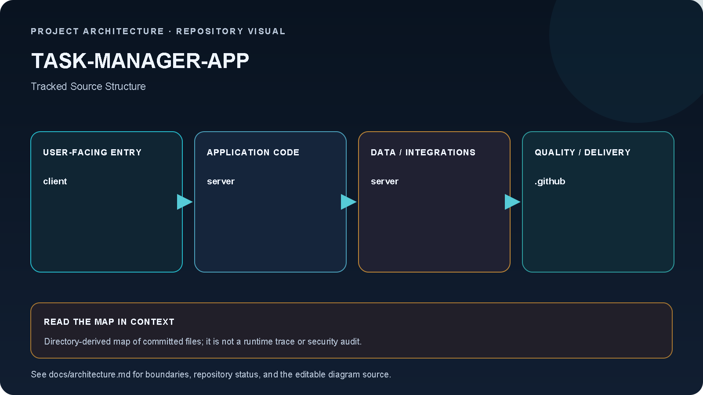
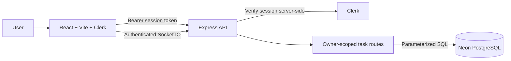

# Task Manager App

<p align="center"><strong>A React and Express task-management application, kept alongside separate project snapshots and experiments.</strong></p>

<p align="center">React | Vite | Express | Socket.IO | Clerk | Neon</p>

## Project overview

The top-level `client/` and `server/` folders form the task-manager application. Clerk provides sign-in; the Express API verifies Clerk session tokens and scopes every task query to the verified user. Neon stores tasks in PostgreSQL. Socket.IO authenticates the same session and emits only to that user's room. This app has no file-upload workflow, so it does not add object storage. Other project-named folders in this repository are separate snapshots, not one combined application.

## Architecture



[Architecture notes](docs/architecture.md) · [Editable SVG](docs/images/task-manager-app-architecture.svg)




## Setup

Requirements: Node.js, a Clerk application, and a Neon PostgreSQL database.

```bash
npm install
npm run install:all
```

Copy `server/.env.example` to `server/.env` and `client/.env.example` to `client/.env`. Apply `server/migrations/0001_tasks.sql` to Neon. Set `DATABASE_URL` and either `CLERK_SECRET_KEY` or `CLERK_JWT_KEY` only in the server environment. Set `VITE_CLERK_PUBLISHABLE_KEY` in the client environment. Configure `CLERK_AUTHORIZED_PARTIES` and `CLIENT_ORIGINS` to the exact frontend origin(s), and `VITE_API_BASE_URL` to the API origin when hosted separately. Never commit secrets or real `.env` files.

Run both apps with `npm run dev`. The API defaults to port `5000`; Vite prints the client URL. The root scripts also provide `npm run build`, `npm test`, and `npm start`.

## Security and data

The server verifies Clerk tokens and derives ownership only from the verified subject. Task updates accept only editable fields; every database query is parameterized and owner-scoped. Socket.IO validates sessions and routes events only to that user's room. Keep the Neon connection string and Clerk secret/JWT keys server-side; only the Clerk publishable key belongs in Vite client configuration. No production credentials are included. The app requires a running Express server and Neon database; a static client deployment alone is not the full app.

## Repository layout

- `client/` and `server/`: primary task-manager application
- `server/migrations/`: PostgreSQL schema
- Other top-level project folders: separate snapshots and experiments

## Live UI preview

[Open the static task-manager preview](https://kalyan870.github.io/task-manager-app/). It uses sample tasks and does not connect to the React/Express backend.
