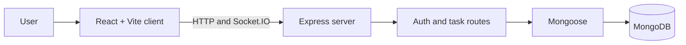

# Task Manager App

<p align="center"><strong>A React and Express task-management application, kept alongside several project snapshots and experiments in one repository.</strong></p>

<p align="center">React · Vite · Express · Socket.IO · MongoDB</p>

## Project overview

The top-level `client/` and `server/` folders form the task-manager application. The server is configured for MongoDB, JWT authentication, and Socket.IO. The repository also contains additional project folders and snapshots (including object counting, monitoring, and other app copies); these folders are not wired together as one application.

## Main app architecture



## Run the task manager

Use Node.js and MongoDB. From the repository root:

```bash
npm install
npm run install:all
```

Copy `server/.env.example` to `server/.env`, set a database URI and a long random `JWT_SECRET`, then run:

```bash
npm run dev
```

The root script starts the server and client together. The API defaults to port `5000`; the Vite client prints its own local URL. `CLIENT_ORIGINS` is a comma-separated CORS allowlist (defaults to local Vite). For a separately hosted frontend, set `VITE_API_BASE_URL` at client build time and include that exact origin in `CLIENT_ORIGINS`. Never commit the real `server/.env` file.

## Scripts

- `npm run dev` — start the client and API
- `npm run build` — build the client
- `npm start` — start the API
- `npm run install:all` — install server and client dependencies
- `npm test` — run task-input safety tests

## Repository layout

- `client/` and `server/` — primary task-manager app
- `object-counting-project/` — separate Streamlit project
- Other top-level project-named folders — additional snapshots; inspect their own manifests before running

## Deployment and data

Task writes accept only documented editable fields, so clients cannot change task ownership. Search terms are escaped as literal text. Socket.IO requires the user's JWT and sends task events only to that user's room. Configure the API URL, allowed frontend origin, MongoDB connection, and secret values in the chosen hosting provider. The app requires a separately running Express server and MongoDB; deploying only the static client is not sufficient. Review production database settings before exposing real user data.


## Live UI preview

[Open the static task-manager preview](https://kalyan870.github.io/task-manager-app/). This preview uses sample tasks and does not connect to the React/Express backend. Full app operation requires MongoDB and JWT configuration as described above.

