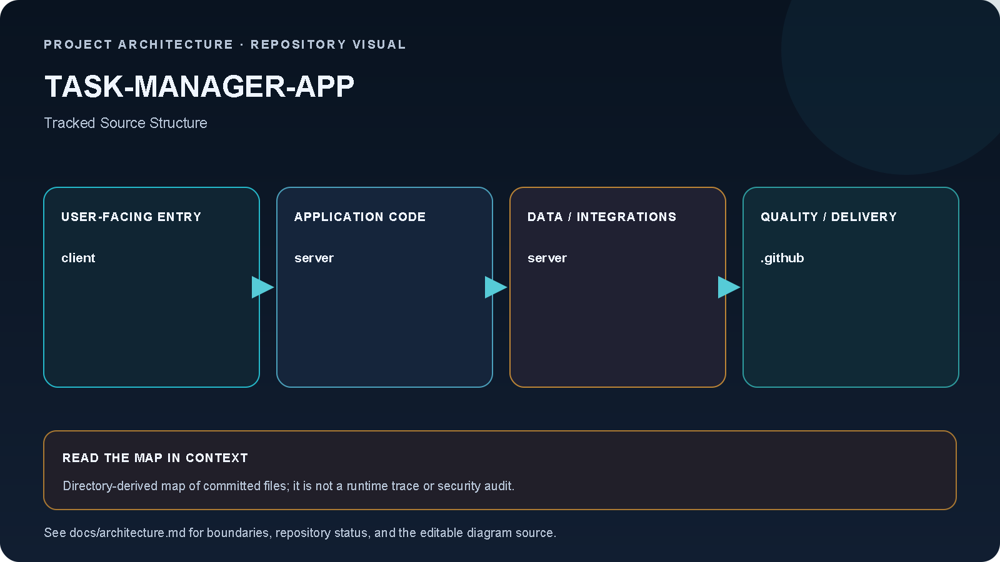

# task-manager-app — architecture and repository status

**Repository:** [https://github.com/kalyan870/task-manager-app](https://github.com/kalyan870/task-manager-app)

**Live link:** https://kalyan870.github.io/task-manager-app/

[Open the editable SVG](images/task-manager-app-architecture.svg)

## What this map represents

Source-tree map; it describes tracked paths and does not claim a tested runtime flow.

## Verified repository facts

- Tracked application/package source is present.
- Default branch: `master`.
- Main language reported by GitHub: `JavaScript`.
- Top-level tracked directories: `.github`, `client`, `object-counting-project`, `server`.
- GitHub Actions workflow present: `yes`.
- Existing build/dependency manifests: `server/package.json`, `object-counting-project/requirements.txt`, `client/package.json`, `package.json`.

## Security and data boundaries

This documentation update does not add sign-in, a database, or file storage. Those belong only where the application has a verified account, durable relational-data, or persistent uploaded-file requirement. Review the application code and deployment settings before using private user data; this map is not a security audit.

## Run and test

Use the commands already documented in the [project README](../README.md). No setup or test command is invented here.
